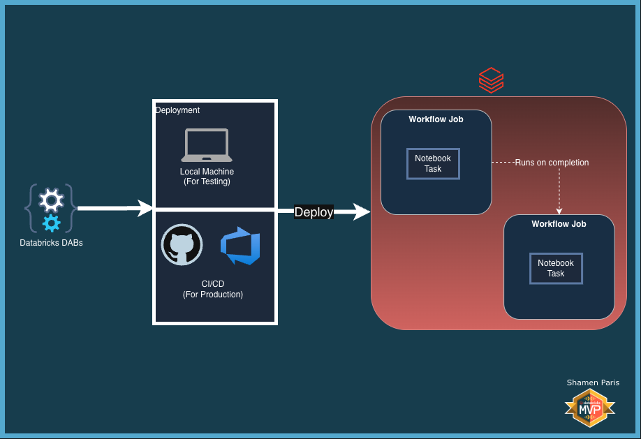
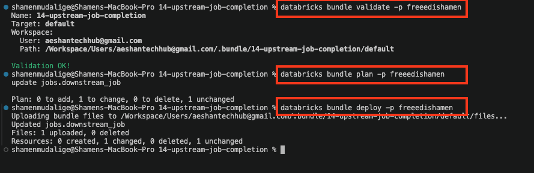
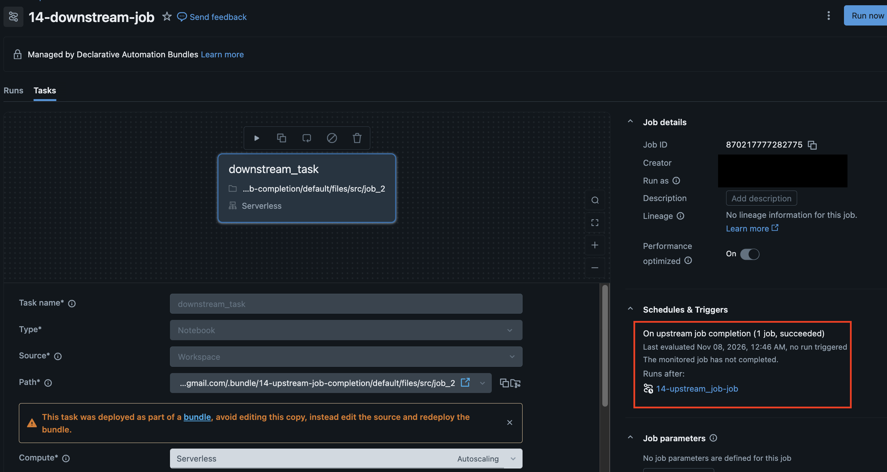

# 14: Upstream Job Completion Trigger

In this module, you will learn how to configure a downstream Databricks Job to automatically trigger as soon as an upstream job completes successfully using the `job_completion` trigger block. This pattern enables loosely coupled, event-driven job chaining across workflows without embedding everything into a single monolithic DAG or master orchestrator.

Key concepts covered:

1. **Job Completion Trigger (`triggers.job_completion`):** Automatically starting a downstream workflow when one or more upstream jobs finish with a specified status (`SUCCESS`, `FAILED`, or `FINISHED`).
2. **Dynamic Resource Reference:** Resolving the upstream job ID dynamically at deployment time using `${resources.jobs.upstream_job.id}` alongside `${var.workspace_id}`.
3. **Serverless Environment v5 & Performance Target:** Running tasks on Serverless compute (`environment_version: "5"`) with `performance_target: PERFORMANCE_OPTIMIZED`.

## What Are We Building?



## Prerequisites and Local Setup

[Prerequisites and Local Setup](../../docs/learning/00-initial-setup/README.md)

### Additional Requirement

The `job_completion` trigger requires your Databricks **Workspace ID**. Update the `workspace_id` default value in `databricks.yml` with your target workspace ID (or pass it at deploy time via `--var="workspace_id=<YOUR_WORKSPACE_ID>"`):

```yaml
variables:
  workspace_id:
    default: "2040867186777008" # Replace with your actual workspace ID
```

## Bundle Structure

1. `databricks.yml` — The master control file that loads `resources/**/*.yml` and defines the `workspace_id` variable.
2. `resources/jobs/upstream_job_complete.yml` — Defines two separate workflows:
   - `upstream_job` (`14-upstream_job-job`): The primary job configured with a cron schedule (`0 0 8 * * ?`, `PAUSED` by default) that executes `src/job_1.py`.
   - `downstream_job` (`14-downstream-job`): The dependent job configured with an active (`UNPAUSED`) `job_completion` trigger watching `upstream_job` for `if_status: SUCCESS`, executing `src/job_2.py`.
3. `src/job_1.py` — The upstream notebook that simulates primary data processing.
4. `src/job_2.py` — The downstream notebook that automatically runs once `upstream_job` succeeds.

## How to Deploy and Run

Once authenticated, navigate to this folder (`14-upstream-job-completion`) in your terminal.

**Step 1: Validate and deploy**

```bash
databricks bundle validate
databricks bundle deploy
```



**Step 2: Verify the trigger in the UI**

Once deployed, open the Databricks Workflows UI and inspect `14-downstream-job`. Under **Schedules & Triggers**, you will see the **Job completion** trigger configured to listen for `14-upstream_job-job`.



**Step 3: Run the upstream job and observe the downstream trigger**

Trigger the upstream job from the CLI (or click **Run now** in the Databricks UI):

```bash
databricks bundle run upstream_job
```

As soon as `14-upstream_job-job` finishes with `SUCCESS`, Databricks automatically triggers `14-downstream-job`.

[View Demo: 04-trigger-job.mp4](../../docs/learning/14-upstream-job-completion/04-trigger-job.mp4)

